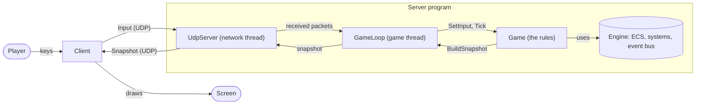

# Architecture

## Folders

| Folder | What is inside |
|--------|----------------|
| `Engine` | The game engine: ECS, systems, game loop, event bus. It knows nothing about R-Type (see [The engine](engine.md)) |
| `Common` | Code shared by the client and the server (protocol, snapshot, inputs) |
| `Server` | The `r-type_server` executable (see [Server](server.md)) |
| `Client` | The `r-type_client` executable (Raylib) |
| `Tests` | Unit tests |
| `Assets` | Images and sounds, copied next to the client executable |
| `Docs` | This documentation |
| `Cmake` | CMake helpers |

## Architecture

The game is a client and server game. The **server is the authority**: it runs the game and decides everything. A client only displays the game and sends what the player presses. It never sends a position.

Text description of the diagram: the player presses keys, and the client sends them to the server as `Input` messages over UDP. Inside the server, the network thread hands the received packets to the game thread. The game loop gives the inputs to the game and makes it advance with `Tick`. The game is built with the engine (entities, components and systems). Every second tick, the loop asks the game for a snapshot, and the network thread sends it to every client over UDP. The client draws the last snapshot on the screen.

## Layers

The code is split in layers that do not know each other's details:

| Layer | Where | Role |
|-------|-------|------|
| Engine | `Engine` | Tools to build a game: entities, components, systems, fixed-step loop, events. The same for every game |
| Game | `rtype::Game` | The rules of R-Type, written with the engine. The only thing the server knows about the game is [six calls](server.md#how-the-server-uses-a-game) |
| Server | `Server` | Network thread, sessions, the 60 Hz loop, snapshots |
| Networking | `Client` (`ServerConnection`), `Common` | Sends inputs, receives snapshots, tracks the connection status. The packet format is shared |
| Rendering | `Client` (`SnapshotRenderer`, `Starfield`, `Menu`, `MenuRenderer`) | Draws. Needs only the types and positions of the entities |
| Audio | `Client` (`Audio::AudioSystem`) | Music and sound effects |

The renderer never needs to know how fast a missile goes or how much damage it does: the server sends a position and a type, nothing else. In the same way, the server never needs to know the rules of the game: it only calls the game.

This is what makes a second game possible: only the game layer and the way the client draws it change. See [Add a new game](add-a-game.md).

## Time

The server advances the game with a **fixed step**: each tick moves the game forward by exactly 1/60 s, whatever the speed of the computer. It sends a snapshot every second tick, which is 30 times per second. The client sends its inputs once per frame (60 per second). The scrolling of the star-field uses timers as well.

## The game world

- The world is `800 x 600` units. `(0, 0)` is the **top-left corner**.
- Sizes: ship `99 x 51`, player missile `16 x 4`, Bydos `48 x 36`, enemy missile `16 x 4`.
- Up to 4 players (ids 0 to 3) and 128 entities per snapshot.
