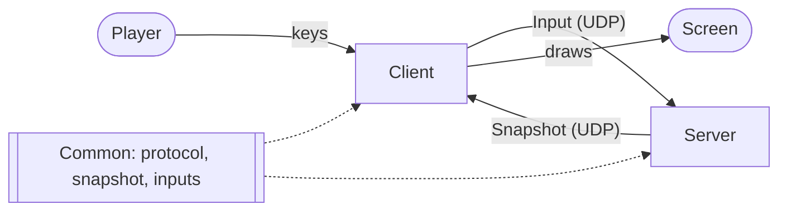

# Architecture

## Folders

| Folder | What is inside |
|--------|----------------|
| `Engine` | The game engine |
| `Common` | Code shared by the client and the server (protocol, snapshot, inputs) |
| `Server` | The `r-type_server` executable |
| `Client` | The `r-type_client` executable (Raylib) |
| `Tests` | Unit tests |
| `Assets` | Images and sounds, copied next to the client executable |
| `Docs` | This documentation |
| `Cmake` | CMake helpers |

## The big picture

The game is a client and server game. The **server is the authority**: it runs the game and decides everything. A client only displays the game and sends what the player presses. It never sends a position.

Text description of the diagram: the player presses keys, and the client sends them to the server as `Input` messages over UDP. The server simulates the game and sends back `Snapshot` messages over UDP. The client draws the last snapshot on the screen. The `Common` library is used by both programs, so they read and write the same messages.

## Layers

The code is split in layers that do not know each other's details:

| Layer | Where | Role |
|-------|-------|------|
| Rendering | `Client` (`SnapshotRenderer`, `Starfield`, `Menu`, `MenuRenderer`) | Draws. Needs only the types and positions of the entities. |
| Networking | `Client` (`ServerConnection`), `Common` | Sends inputs, receives snapshots, tracks the connection status. |
| Game logic | `Server`, `Engine` | Simulates the game: movement, shots, collisions, lives, score. |
| Audio | `Client` (`Audio::AudioSystem`) | Music and sound effects. |

The renderer never needs to know how fast a missile goes or how much damage it does: the server sends a position and a type, nothing else.

## Time

The server simulates at 60 ticks per second and sends a snapshot about 30 times per second. The client sends its inputs once per frame (60 per second). Nothing depends on the speed of the CPU: movements and the scrolling of the star-field use timers.

## The game world

- The world is `800 x 600` units. `(0, 0)` is the **top-left corner**.
- Sizes: ship `99 x 51`, player missile `16 x 4`, Bydos `48 x 36`, enemy missile `16 x 4`.
- Up to 4 players (ids 0 to 3) and 128 entities per snapshot.

## Where to go next

- How the client works: [Client](client.md).
- What goes on the network: [Network protocol](protocol.md).
